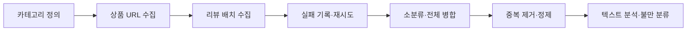

# 무신사 리뷰 수집·정제 파이프라인

**카테고리별 상품 탐색부터 리뷰 수집, 실패 재시도, 중복 제거와 텍스트 분석까지 연결한 데이터 수집 프로젝트입니다.**

2026-1 텍스트마이닝 팀 프로젝트 · Python / Playwright / Requests / pandas

최종 정제 데이터는 **리뷰 391,182건·상품 7,687개**입니다. 수집 데이터를 활용한 18개 불만 유형 분류는 [모델 저장소](https://github.com/riex71/fashion-review-mining)에서 확인할 수 있습니다.

**본인 기여:** 데이터 수집·처리, 모델링 또는 분석 구현, 실험과 결과 정리 전반을 주도했습니다. 팀 공동 참여 프로젝트입니다.

## 전체 흐름



## 구현에서 중점을 둔 부분

- **다시 시작할 수 있는 수집:** 8개 청크, 상품 100개 배치, 처리·실패 목록과 오류 로그로 수집 상태를 관리했습니다.
- **부분 실패 처리:** 실패 상품을 완료 목록에 넣지 않고 재시도 대상으로 남겼습니다.
- **수집 품질 점검:** 카테고리별 URL 수, 중복, 처리 상태를 수집 단계별로 확인했습니다.
- **정제:** `review_id`와 상품·정규화 텍스트를 기준으로 중복을 제거하고 불필요한 `raw_json`을 삭제했습니다.
- **표본의 한계 기록:** 카테고리별 스크롤 수와 상품별 리뷰 수를 제한하므로 전수 수집이 아닙니다.

## 결과

| 항목 | 기존 분석 기록 |
|---|---:|
| 정제 리뷰 수 | 391,182 |
| 상품 수 | 7,687 |
| 평균 평점 | 4.7774 |
| 4점 이상 비율 | 96.17% |
| 2점 이하 비율 | 1.37% |

고평점에 치우친 분포를 확인했고, 후속 분류 프로젝트에서는 별점과 불만 여부를 분리해 정의했습니다. 원본 CSV 약 1.3GB를 정제본 약 282MB로 줄인 내용과 수집 중 문제 해결 과정은 [기존 작업 기록](docs/collection-notes.md)에 보존했습니다.

## 코드와 분석 결과

| 목적 | 파일 |
|---|---|
| 상품 URL 수집·점검 | [collect_urls.py](collect_urls.py), [check_collect_urls.py](check_collect_urls.py) |
| 리뷰 수집·점검 | [crawler.py](crawler.py), [check_crawler.py](check_crawler.py) |
| 특정 카테고리 재시도 | [crawler_retry_107001.py](crawler_retry_107001.py) |
| 병합 | [merge_small_to_big.py](merge_small_to_big.py), [merge_all.py](merge_all.py) |
| 정제 | [clean_reviews.py](clean_reviews.py) |
| 기존 분석 코드 | [nlp_analysis.py](nlp_analysis.py) |
| 분석 산출물 | [분석 보고서](analysis_final/report.md), [차트 PDF](analysis_final/charts.pdf) |

## 실행 순서

프로젝트 환경은 [pyproject.toml](pyproject.toml)과 [uv.lock](uv.lock)을 사용합니다. 아래는 수집 파이프라인의 실행 순서이며, 외부 사이트에 대한 수집을 수행합니다. 현재 사이트/API 호환성은 이번 문서 정리에서 재검증하지 않았습니다.

```bash
uv sync
uv run playwright install chromium
uv run python collect_urls.py
uv run python check_collect_urls.py
uv run python crawler.py
uv run python check_crawler.py
uv run python merge_small_to_big.py
uv run python merge_all.py
uv run python clean_reviews.py
```

`crawler.py`는 실행 중 청크 번호를 입력받습니다. 상품당 리뷰 수 제한과 카테고리 범위는 실행 전에 코드 및 `category_master.csv`에서 확인합니다. NLP 분석은 별도 분석 의존성·경로 확인이 필요하며, 저장된 분석 결과는 위 링크에서 바로 읽을 수 있습니다.

## 데이터 범위와 한계

상품당 최대 100개 리뷰와 제한된 스크롤로 확보한 표본이므로, 전체 무신사 이용자나 모든 상품의 리뷰 분포를 대표한다고 볼 수 없습니다. 최신 리뷰에 치우칠 수 있는 수집 방식과 고평점 편향을 분석 시 고려해야 합니다.

코드 공개와 수집 데이터의 재배포 권한은 별개입니다. 원문 리뷰·작성자 관련 필드의 이용 범위를 확인하고 필요한 최소 데이터만 사용해야 합니다.
